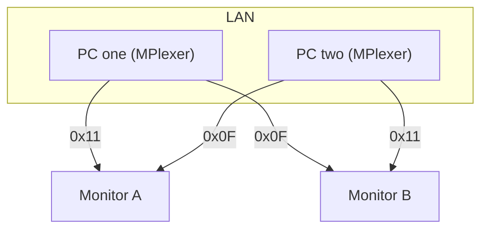

# MPlexer

MPlexer switches monitor input sources over DDC/CI, so you can move a display between its HDMI or DisplayPort inputs from software instead of the buttons on the bezel. It also finds the other machines running MPlexer on your LAN and hands a switch off to whichever one is physically cabled to the monitor, which makes a set of shared screens behave like a software KVM.

The window scans the attached displays and shows each as a tile with its model, serial and EDID details (panel size, native resolution, manufacture date, EDID version) plus an input dropdown. Displays that do not answer DDC/CI, which includes most TVs, still show up but are marked as not controllable. Peers discovered on the network appear in the side panel, and linking to one lets a switch requested here run on the machine that owns the connection.

A typical setup has each machine cabled to every shared monitor, so any given display can show any machine depending on which input it is set to. The instances keep a TCP link between them to sync monitor state and to forward switch requests, since the machine you are sitting at is often not the one wired to the monitor you want to change. The labels on the display links below are the VCP 0x60 codes each monitor uses to select that feed.



```
cargo run                       # GUI
cargo run -- --cli list         # enumerate monitors and their inputs
cargo run -- --cli get "#0"     # read one monitor's current input
cargo run -- --cli set "#0" 0x11 --yes   # write VCP 0x60 (writes need --yes)
```

## Input codes

The input source is exposed by DDC/CI as VCP feature 0x60, and both reading and writing it deal in raw one-byte codes such as 0x0F or 0x11. The MCCS standard gives some of these values nominal meanings, but vendors drift from it freely, reusing codes, inventing their own and rarely saying which physical port a code maps to, so a code on its own is not enough to tell you it is the HDMI socket on the left. A monitor can advertise its valid 0x60 values in its capabilities string, yet plenty of them, including some tested here, report a bare VCP 60 entry with no value list at all.

Because there is no dependable way to enumerate a display's inputs up front, MPlexer learns them by observation. It seeds from the capabilities list when one exists, records whatever code the monitor currently reports, and remembers each new code it sees whenever an input actually changes, persisting the set per monitor so the dropdown fills in with the values known to work on that particular screen. That is also why the interface shows hex rather than friendly names, since the code is the only ground truth the display gives back, and you can attach your own label to a code through `input_labels` in the config to have it shown in place.
